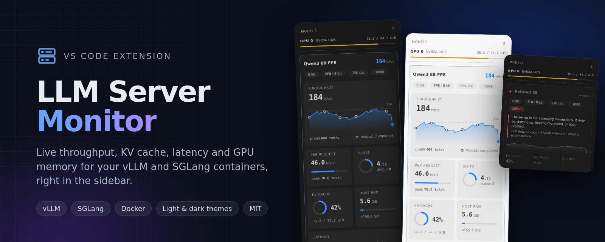
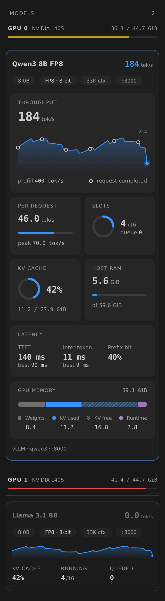
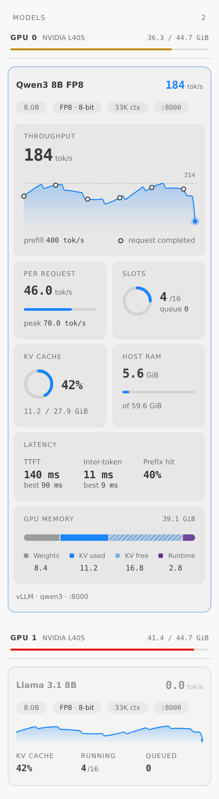
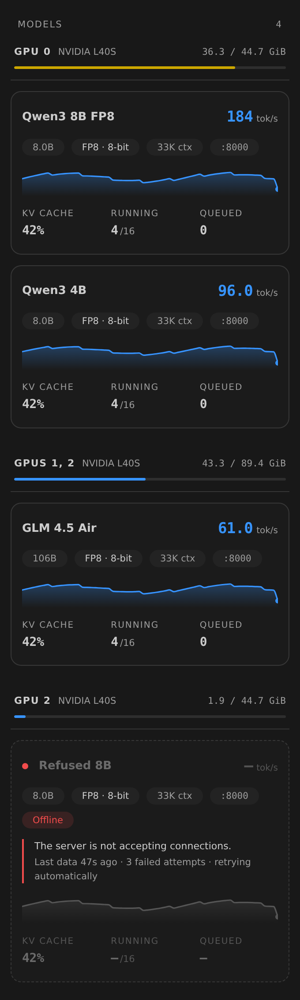
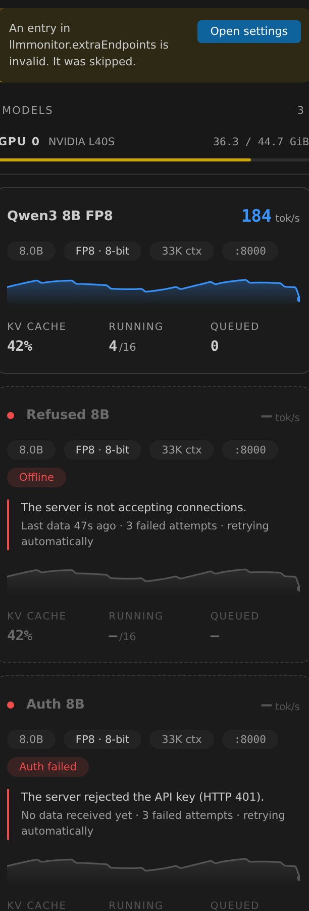
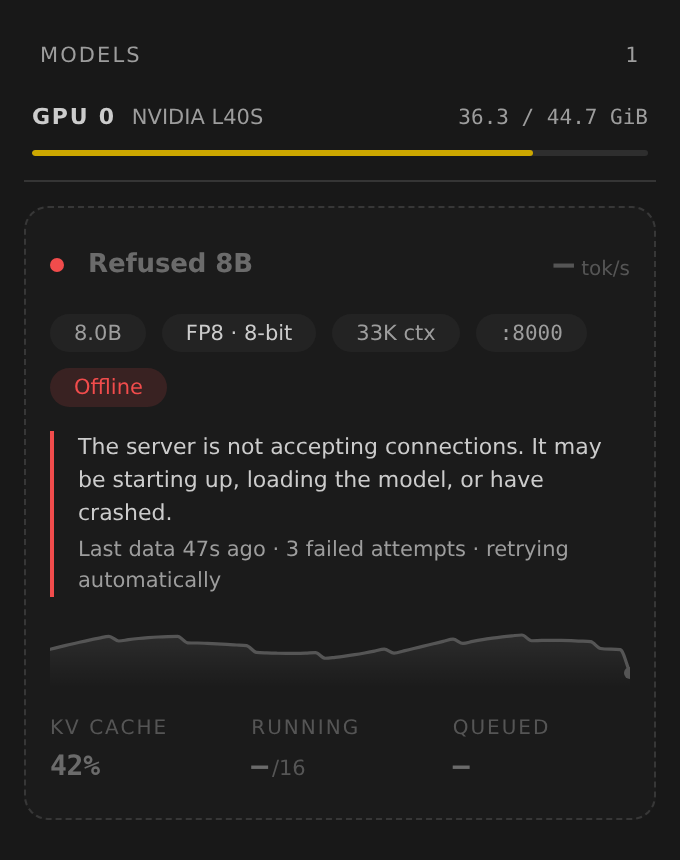
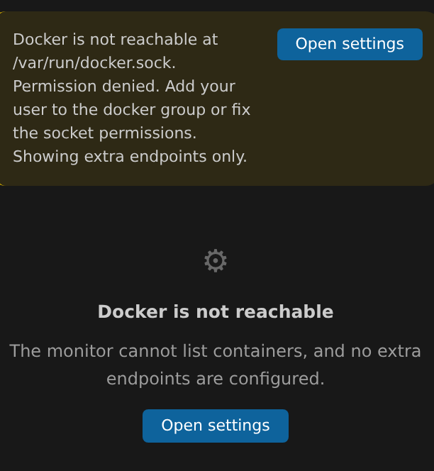
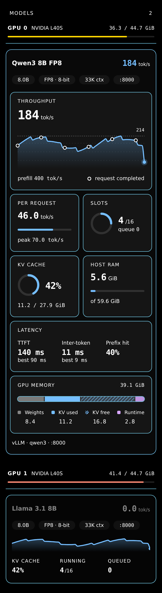
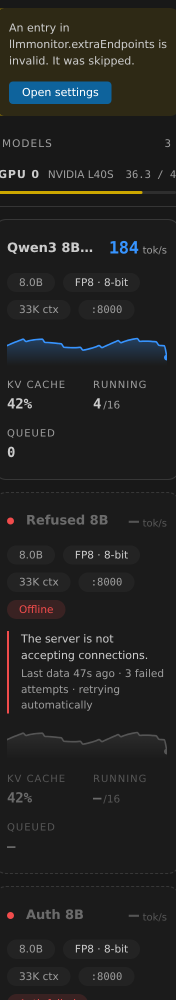
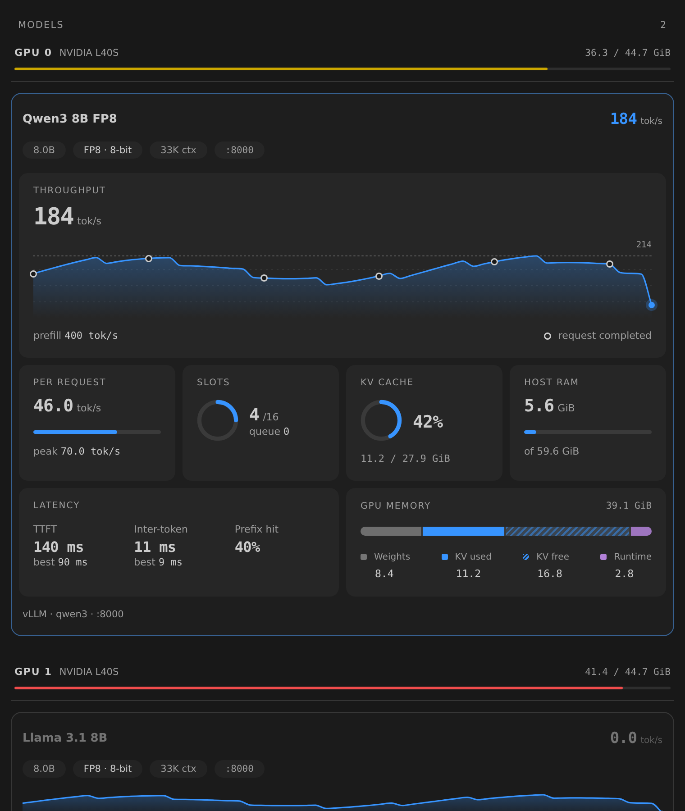

<p align="center">
  
</p>

<p align="center">
  
  
  
  
</p>

# LLM Server Monitor

A VS Code sidebar panel that finds the **vLLM** and **SGLang** servers running in Docker on your machine and shows what each one is doing, live: throughput, KV cache, request slots, latency and GPU memory. No dashboards to host and no Prometheus or Grafana to set up. Start a container and its card appears.

<p align="center">
  
  &nbsp;&nbsp;
  
</p>

## Features

- **Automatic discovery.** Finds vLLM and SGLang containers through the Docker socket, works out their port, API key and launch options, and adds or removes cards as containers come and go.
- **Grouped by GPU.** Models are listed under the GPU they run on ("GPU 0 · L40S", with that GPU's memory in use), and a model spread over several GPUs gets its own group. Every card has its own border, so neighbouring models are easy to tell apart.
- **Only inference servers.** Routers, gateways, proxies and load balancers (SGLang router, LiteLLM, nginx and similar) are skipped, and you can hide any other container by name or label.
- **Smooth live throughput chart.** A scrolling 60-sample chart with a dotted peak line, and a marker for every completed request.
- **The numbers that matter.** Tokens/s, tokens/s per request, prefill tokens/s, running and queued requests against the slot limit, KV cache use, host RAM, TTFT, inter-token latency (with the best value seen), and prefix-cache hit rate.
- **GPU memory breakdown.** One bar splitting the container's GPU memory into weights, KV cache used, KV cache free and runtime (CUDA graphs, activations).
- **Model facts.** Parameter count, weight precision (FP8, AWQ, BF16 and so on), context length and port, as chips on each card.
- **Follows your VS Code theme.** Light, dark and both high-contrast themes, switching instantly with no reload.
- **Responsive.** The layout reflows with the width of the side panel: one column when narrow, two normally, four when wide.
- **Honest about failures.** It says what is wrong (offline, still starting, bad API key, no metrics, Docker unreachable) and keeps the last known values on screen, dimmed, instead of going blank.
- **Remote and non-Docker servers.** Point it at any vLLM or SGLang endpoint with a setting.

## Screenshots

| Models grouped by GPU | Collapsed list with a mix of states |
|:--:|:--:|
|  |  |

| Server offline | Docker unreachable |
|:--:|:--:|
|  |  |

| High-contrast theme | Narrow panel |
|:--:|:--:|
|  |  |

| Wide panel |
|:--:|
|  |

The screenshots are rendered from the real panel with sample data (`npm run preview`), not from a live server.

## Requirements

- VS Code 1.80 or newer. A local window or a Remote-SSH window both work; the extension runs next to your containers.
- Docker, with access to its socket (`/var/run/docker.sock` by default).
- vLLM or SGLang with Prometheus metrics on. vLLM exposes them by default; start SGLang with `--enable-metrics`.
- `nvidia-smi` on the same machine, for the GPU memory card. Everything else works without it.

## Install

### From a `.vsix`

1. Download `llm-monitoring-service-0.1.0.vsix` from the repository's Releases page, or build it yourself (below).
2. Run `code --install-extension llm-monitoring-service-0.1.0.vsix`, or use **Extensions → … → Install from VSIX…**.
3. Open the **LLM Server Monitor** icon in the activity bar.

### From source

```bash
git clone https://github.com/Minato3000/model-monitoring-service.git
cd model-monitoring-service
npm install
npm run package          # compiles and writes llm-monitoring-service-0.1.0.vsix
code --install-extension llm-monitoring-service-0.1.0.vsix
```

Press **F5** in VS Code to run the extension in a development host instead.

## Using the panel

Each running server is one card. Click a card to expand it; only one card is open at a time.

| Collapsed card | Shows |
|---|---|
| Header | Model name and live tokens/s |
| Chips | Parameters, weight precision, context length, port |
| Mini chart | Recent throughput |
| Stats | KV cache %, running requests out of the slot limit, queued requests |

| Expanded tile | Shows |
|---|---|
| **Throughput** | Live tokens/s, scrolling chart, dotted peak line, prefill rate, completed-request markers |
| **Per request** | Tokens/s each request gets, against the best seen |
| **Slots** | Running requests against the maximum, plus queue length |
| **KV cache** | Use as a percentage and as GiB (marked `~` when estimated) |
| **Host RAM** | Container memory without reclaimable page cache |
| **Latency** | TTFT, inter-token latency (each with the best value seen so far), prefix-cache hit rate |
| **GPU memory** | Weights, KV used, KV free and runtime, as a bar and a legend |

"Best" TTFT and inter-token values are the lowest per-poll averages since the extension started, held in memory per server.

## When something goes wrong

| Situation | What you see |
|---|---|
| Server refused the connection, reset it, or timed out | Status chip (Offline, Restarting, Not responding), the cause, "last data 42s ago", and the card dimmed with its last values kept |
| Container just started | "Starting" chip while the model loads, instead of an error |
| Wrong API key (401/403) | "Auth failed" chip |
| `/metrics` missing (404) | "No metrics" chip, with the fix for each engine |
| Server error (5xx), unknown host, invalid URL | A matching chip and message |
| Docker socket missing or permission denied | Banner with an **Open settings** button |
| `nvidia-smi` missing or failing | A note inside the GPU memory tile; the rest keeps working |
| No servers found | An empty state with setup hints |
| Extension host stalled | "No update for N s" banner with **Retry** |
| Invalid `extraEndpoints` entry or refresh interval | The entry is skipped with a banner; the interval is clamped to 500–30000 ms |

After a failure the monitor re-reads the model name and restarts its counters, so a server that restarts, even with a different model, does not produce a throughput spike.

## Settings

| Setting | Default | Description |
|---|---|---|
| `llmmonitor.refreshInterval` | `2000` | Milliseconds between polls (500–30000) |
| `llmmonitor.dockerSocket` | `/var/run/docker.sock` | Rootless Docker and Podman use a different path |
| `llmmonitor.nvidiaSmiPath` | `nvidia-smi` | Path to the `nvidia-smi` binary |
| `llmmonitor.extraEndpoints` | `[]` | Servers outside Docker, or on another host |
| `llmmonitor.excludeContainers` | `[]` | Container names (or parts of names) to hide from the panel |

Example for a remote server:

```json
"llmmonitor.extraEndpoints": [
  { "engine": "vllm", "url": "http://gpu-box:8000", "name": "gpu-box", "apiKey": "sk-..." }
]
```

A container is treated as vLLM or SGLang when its command line mentions `vllm` or `sglang`. To force it, add the label `llm.monitor=vllm` or `llm.monitor=sglang`; to hide a container, use `llm.monitor=ignore` or list it in `llmmonitor.excludeContainers`.

**Gateways and load balancers are not shown.** A container is skipped when its name, image or launch command contains `router`, `gateway`, `proxy`, `balancer`, `litellm`, `nginx`, `haproxy`, `envoy`, `traefik`, `caddy`, `kong` or `istio`. They have no GPU or engine metrics of their own. Support for showing them is planned. The `llm.monitor=vllm|sglang` label overrides the skip if a real server is caught by mistake.

## How it works

- **Discovery:** the Docker Engine API over the unix socket. The endpoint comes from `--port`, the published port, or the container's IP. `--api-key` or the `API_KEY` environment variable is sent as a Bearer token.
- **Live numbers:** the engine's Prometheus `/metrics`, polled on the refresh interval. Rates come from counter deltas between polls, and counter resets are ignored.
- **Static numbers:** weights and KV allocation are parsed once from the container's startup log, and parameters and precision from the model's `config.json` and weight files when they are reachable through a bind mount. Servers started with `--log-level warning` do not print the KV allocation, so that value is estimated or shown as "—".
- **GPU memory and grouping:** the container's PIDs (`docker top`) matched against `nvidia-smi --query-compute-apps`, which also tells which GPU each process uses. If `nvidia-smi` cannot map the processes, the GPUs docker assigned to the container (`--gpus device=0,1`, `NVIDIA_VISIBLE_DEVICES`) are used. Servers whose GPU is unknown (remote endpoints, no `nvidia-smi`) are listed under "GPU unknown" at the end.
- **Theming:** the panel uses only VS Code's theme variables, with state colours defined once per card in CSS, so a theme change needs no reload.

## Development

```bash
npm install
npm run compile            # type-check and build to out/
npm run watch              # rebuild on change
```

Tools for working on the UI and the failure paths without a GPU:

| Command | What it does |
|---|---|
| `npm run mock` | Starts fake vLLM and SGLang servers that fail in different ways (401, 404, 500, timeout, counter reset, junk metrics, dropped sockets) and prints the `extraEndpoints` settings to paste |
| `npm run test:scenarios` | Polls those servers through the real adapters, checks each outcome, and checks that gateways are skipped and real servers are not |
| `npm run preview` | Writes `out/preview.html`: the panel in a browser with dark, light and high-contrast themes, three widths and every state |

```
src/
  extension.ts   view provider, polling loop, notices
  docker.ts      container discovery, GPU and RAM readings
  adapters.ts    vLLM and SGLang metric handling, error states
  prom.ts        Prometheus parser, HTTP helpers, error classification
  modelinfo.ts   startup-log and model-file parsing
  webview.ts     the panel UI (HTML, CSS and script)
scripts/         mock server, scenario test, preview builder
docs/            banner and screenshots
```

## Contributing

Issues and pull requests are welcome. For UI changes, include a screenshot from `npm run preview` in the theme and width you tested.

## License

[MIT](LICENSE) © 2026 Raghuram
